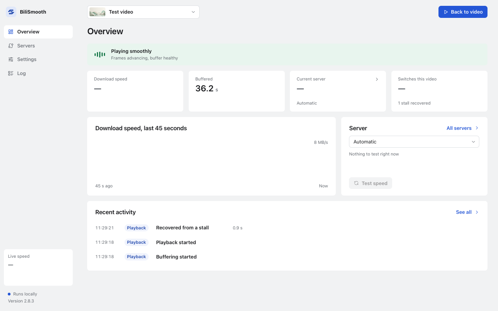

# BiliSmooth

[简体中文](./README.md) | **English**

Switch the CDN server for Bilibili videos and see download speed and buffered time beside the player.

[Download](https://github.com/Planetes1mal/BiliSmooth/releases/latest) · [Changelog](./CHANGELOG.md) · [Report an issue](https://github.com/Planetes1mal/BiliSmooth/issues)

https://github.com/user-attachments/assets/b77ef928-578d-4daf-9b2a-bfd4483d183d

*Footage: Spring © Blender Foundation | [cloud.blender.org/spring](https://cloud.blender.org/spring), [CC BY 4.0](https://creativecommons.org/licenses/by/4.0/).*

## Features

- **Status beside the video:** see download speed, buffered time and the active server in a control you can drag, dock or collapse.
- **Buffer adjusted for playback speed:** 20 seconds of buffered video shows as about 10 seconds at 2× speed.
- **Automatic or manual server choice:** let BiliSmooth pick a CDN server or keep a fixed one. Try another server when playback stalls.
- **A separate dashboard:** view download history and server information, adjust settings, and choose Chinese or English with a light or dark theme.

## Install

For desktop Chrome and Edge. Chrome requires version 120 or later.

### Chrome Web Store

1. Open the [Chrome Web Store](https://chromewebstore.google.com/detail/obhciaoeldnglalhhkmopkdolkonipfd) and click **Add to Chrome**.
2. Refresh your Bilibili video page to load the floating control. Click the extension's browser toolbar icon to open the dashboard.

### Manual installation from a GitHub ZIP

1. Open the [latest release](https://github.com/Planetes1mal/BiliSmooth/releases/latest), download `BiliSmooth-<version>.zip`, and extract it.
2. Open `chrome://extensions`, or `edge://extensions` in Edge.
3. Enable **Developer mode**, then click **Load unpacked**.
4. Select the extracted folder containing `manifest.json`.
5. Refresh your Bilibili video page to load the floating control. Click the extension's browser toolbar icon to open the dashboard.

Download the BiliSmooth installation ZIP, rather than GitHub's **Source code** archives. Keep the extracted folder in place; the browser loads the extension from it.

**Update:** Extract the new files into the existing installation folder, reload BiliSmooth on the extensions page, and refresh your video pages. Your settings are retained.

## Use

Open a Bilibili video as usual. The server is set to “Automatic” by default. Hover over the floating control for metrics, or click it to choose a server or test speed. Choosing a fixed server pauses automatic switching. Choose what the collapsed control shows in the dashboard's settings.

To go back to Bilibili's own server choice, choose “Bilibili default” in the floating control and refresh the page when prompted.

BiliSmooth preserves the quality selected in the player. It does not unlock paid quality options or bypass regional restrictions. Server performance varies with your network.

## Privacy

No additional account is required, and no telemetry is sent to the developer. Settings stay on your device. Playback requests go to the selected CDN; when MCDN proxying is enabled, they pass through the configured proxy service.

See the [privacy policy](./PRIVACY.en.md) for data handling and permission details.

## Contributing and license

Report problems or suggest improvements in [Issues](https://github.com/Planetes1mal/BiliSmooth/issues).

BiliSmooth is [MIT licensed](./LICENSE). Its routing and configuration code adapts [realzza/bilibili-accelerator](https://github.com/realzza/bilibili-accelerator). The interface uses Motion and Tabler Icons. See the [third-party notices](./NOTICE.md) for attribution.
